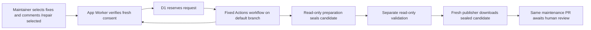

# Node maintenance repair: design and delivery slices

This is the governing design for a shared GitHub App, Cloudflare Worker and
bounded follow-up repairs in GitHub Actions. It replaces the proposed seven
commits in the earlier replan. PR #41 remains parked. This document specifies
future behavior; a design review does not establish deployed behavior.

## Outcome and scope

A maintainer selects exact package fixes in a maintenance PR description and
posts a new comment containing only `/repair selected` using GitHub's normal
**Comment** button. Selection, submission and request status are available in
the main PR conversation. A supporting native Check remains available as a
secondary entry point; navigating to Checks is not required. The App dispatches
one attempt to the repository's Actions. A successful attempt
pushes the exact validated candidate to that PR. Merging remains a human decision.

This amendment incorporates the approved conversation flow and the live-tested
neutral Check lifecycle from PR #46. Its harmless pilot verified admission,
dispatch and replay, not dependency repair or completion handling. Preserve the
review and ownership history of issued slices 1–3. The standalone conversation
follow-up is an existing predecessor of the replacement completion slice,
not a claim that completion or
G-INFRA is complete. Its reviewed source is
`475355edb87693bb970d28d6674c295df476684f`.

The first repair changes exact, unqualified `overrides.<package>` values in
`pnpm-workspace.yaml` to stable patches in the same major and minor. Only
`pnpm-workspace.yaml` and `pnpm-lock.yaml`, in the configured Node project,
may change. Existing runtime selection, release cooldown, parent compatibility,
project checks and local-patch policy remain in force. Unknown compatibility
or unavailable audit/registry evidence blocks the attempt.

Excluded: npm repairs, range or parent-qualified overrides, major/minor jumps,
new transitive package versions outside the selected package set, pin-history
investigation (#40), agent-written repairs, automatic merges, and broad rollout.
Existing audit and Node platform security behavior must continue to work.

## Delivery boundaries and first batch

Each issued slice is one independently reviewed behavior. Use its exact ID and
title for its commit and PR. Do not put the entire inventory into a replacement
monolithic PR. Complete and validate a predecessor before starting its successor.
Preserve PR #41 and extract only the current slice's responsibility from it.

The initial delivery selected slices `node-maintenance-repair/1` through `/4`.
The amended completion responsibility is its replacement child `/4.1`; `/4`
remains recorded as replaced. Preserve the mapped prefix `/1`–`/3` and all
consumed campaign history. Continue with `/4.1`, not a fresh campaign.
These prove the infrastructure with a harmless workflow in an explicitly
authorized pilot repository and PR. The current infrastructure target is
`hydra-ecosystem/hydra` PR #3572; the fixture checks out no PR code and changes
no dependencies. Future write-enabled repair tests still require G-REPAIR's
isolated PR. Repair code starts only after **G-INFRA** passes. Passing local tests,
obtaining PR approval, or deploying a Worker alone cannot satisfy G-INFRA.

`swe:deliver-design-stack` supplies reviewed PR-stack approval. It does not
authorize merge, App registration, installation, resource creation or deployment.
An operator must supply those actions and their evidence at the stated gates.
If that evidence is unavailable, stop the affected slice; do not downgrade its
acceptance check or proceed to repair work. No merge is part of this plan's
automatic stopping point.

### Operator boundary G-SETUP

Before any live operation, record the chosen GitHub App owner/slug, pilot
repository, Cloudflare account, Worker environment/URL and D1 binding in a
sanitized pilot receipt. Reuse already approved targets and grants. Ask only when a required target
or protected operation remains unresolved. App credentials and Cloudflare credentials belong only in the
operator's secret storage. They are never repository files or evidence fields.

Use one public App and one shared Worker/D1 service. Install it on selected
repositories in an organization or personal account. App permissions are
Contents read, Pull requests write, Issues read, Checks write and Actions write;
Metadata read is implicit. Issues read admits canonical source-comment reads;
Pull requests write updates App-owned replies on the PR. GitHub scopes Actions write to the selected repository, so the
fixed workflow restriction below is enforced by this service. There is no
contents-write App permission. Narrow each installation token to the event's
repository ID and only the permissions needed for the operation.

Registration, installation, database creation and preview deployment need explicit
operator authorization for the named targets. Delivery may use an explicitly
approved preview Worker built from the reviewed slice without merging it.
Uninstalling the App and disabling the pilot workflow stops new requests;
cancel any already dispatched Actions run separately. Restoring the prior
Worker version does not erase D1 receipts.

### Live acceptance gate G-INFRA

Slices 1–4 must retain real GitHub delivery/check/run URLs and sanitized evidence:

1. A real signed ping reaches the deployed receiver. An invalid signature fails.
   An installation token can read the chosen repository and cannot access a
   repository outside its narrowed scope.
2. A managed bot-authored PR shows the exact selected versions in its
   description and supporting Check. Changes to selections or PR revisions
   invalidate old consent.
3. An authorized maintainer posts `/repair selected` in the PR conversation.
   The supporting native action retains its existing authorization checks.
   Exactly the selected inputs arrive in one harmless Actions run on the default
   branch. The API returns that run's ID. Redelivery and concurrent requests
   cannot dispatch another active attempt for the same PR.
4. Real success, failure and cancellation update the existing App-owned PR reply
   and original supporting Check with the recorded run link. Verified completion
   releases only that request's lock. Unauthorized requests and stale consent
   start no run. Cross-installation events cannot read or update another
   installation's request.

The pilot workflow is a checked-in installation fixture copied to
`.github/workflows/dependency-repair.yml` on the pilot repository's default
branch. It accepts the final five inputs, validates their shape and writes a
sanitized summary. It checks out no PR code, has read-only permissions, does no
dependency work and makes no repository changes. A controlled failure branch
belongs only to the fixture. The service has no pilot dispatch mode or alternate
endpoint. Later the pilot caller is replaced with the real reusable workflow.

## Architecture and trust



The Worker processes metadata and makes bounded GitHub API calls. It never
clones or executes repository code. The preparation and validation runners
have no write credentials. Only the fresh publisher can push. Its code and
actions come from the reviewed maintenance workflow reference, never PR-local
action definitions. Validation-runner files are evidence for humans and are
not publisher inputs. These are mandatory boundaries, not optional hardening.

No new service beyond Worker and D1 is required. No queue, external selection
page, label listener or retry daemon is introduced. The conversation command
uses the existing App webhook. D1 exists
for durable reservations and known run IDs. Reuse existing Node audit and
project validation functions rather than introducing a parallel audit engine.

## Contracts

### C1: managed PR and selected batch

The PR must be open, bot-authored, from `maintenance/node-security` in the same
repository, and target its current default branch. Fork PRs are rejected. At
request time, fetch the canonical repository, PR and Check from GitHub. Require
this App to own the Check, its head SHA to equal the PR head and its idle
identity to match the current selection fingerprint. A user with current write,
maintain or admin permission may request an attempt.

The PR contains exactly one pair of these markers, in this order:

```markdown
<!-- node-repair:selection:v1 -->
- [ ] Allow `launch-editor` `2.14.1 → 2.14.2` by updating its explicit pin.
<!-- /node-repair:selection -->
```

Every line between the markers must match that exact grammar. Accept `x` or
`X` as checked; an empty selection hides the action. Reject duplicate packages,
extra marker pairs, malformed lines and non-stable versions. Select 1–20
distinct packages. Each item is exactly `{name, from, to}`, with string values;
`to` is a larger patch in the same major and minor. Names use lowercase npm
name syntax, including optional scope. Sort by name using code-point order.
JavaScript and Python share fixtures for valid and invalid inputs.

The idle Check external ID is `node-repair:<pr_number>:<fingerprint>`.
The fingerprint is SHA-256 of UTF-8 compact JSON
`[pr_number, head_sha, base_sha, sorted_items]`. Construct each item in the
key order `name`, `from`, `to` so the two runtimes hash identical bytes. Neither
checkbox editing nor a PR webhook authorizes dispatch. A stale request starts
no run and asks the user to review the current report and submit again.

The report includes one hidden revision marker outside the selection block
(replace the placeholders with the exact 40-character lowercase revisions):

```markdown
<!-- node-repair:revision:v1 <exact-head-sha> <exact-base-sha> -->
```

Only a new human `issue_comment.created` whose trimmed body is exactly
`/repair selected` is a conversation command. Fetch its canonical comment and
require the same ID, PR association, author, exact body and unedited timestamps.
Compare the selection snapshot in the signed event with the current canonical
PR, and require its revision marker to match the current head and base. Verify
current write, maintain or admin permission before any reply or admission.
Edits, deleted comments, quoted commands and unrelated text authorize nothing.
The native Check action uses the same admission and fixed dispatch path.

### C2: webhook, dispatch and admission

Only POST `/webhook` is accepted. Verify `X-Hub-Signature-256` over the original
request bytes before parsing JSON. Require configured secrets, valid delivery
and installation/repository IDs, and at most 2,000,000 body bytes. Reject while
streaming past that limit; do not buffer an unbounded body first. Wrong routes
return 404, bad signatures 401, oversized bodies 413, missing config 503 and
processing failure 500. A verified ignored event returns 200. Never log tokens,
private keys, whole payloads or upstream response bodies.

Subscribe to `pull_request` (opened, edited, synchronize, reopened), `check_run`
(requested_action), `issue_comment` (created) and `workflow_run` (completed),
plus GitHub's ping. Update the
Check named **Dependency repair** on PR changes. Its secondary native action identifier
is `repair-selected`, with label **Run selected fixes**. Use only one action.
The selected items appear in the Check summary; GitHub's Check has no embedded
checkbox controls. Selection remains in the PR description.

Dispatch only `.github/workflows/dependency-repair.yml` at the current default
branch. Send these required string inputs; never accept a user-supplied ref,
workflow, repository, command or callback URL:

| Input | Value |
| --- | --- |
| `request-id` | Valid GitHub delivery UUID for this request |
| `pull-request` | Positive decimal PR number |
| `expected-head` | Exact 40-character lowercase head SHA |
| `expected-base` | Exact 40-character lowercase base SHA |
| `selections` | Compact JSON of C1's sorted items |

Use API version `2026-03-10` and require the documented HTTP 200 dispatch
response with positive `workflow_run_id` and repository-matching `run_url` and
`html_url`. Store that ID. Do not search by workflow title or accept HTTP 204
as confirmed dispatch. Validate this response contract in G-INFRA before repair
work; incompatible behavior stops delivery rather than adding a fallback.

### C3: durable request state and failure direction

D1 stores one `requests` row per delivery UUID with installation ID, repository
ID/name, PR, head/base SHA, dispatched default-branch ref, fingerprint, Check ID,
actor login, creation time, completion time, state and nullable run ID/URL and
GitHub conclusion. Comment requests also retain source comment ID, App reply ID
and exact sorted selections. IDs are positive integers except the delivery UUID
and SHAs; times are UTC epoch milliseconds. Completion time, run ID/URL and
conclusion start null. Required states are `reserved`, `dispatched`, `unknown`,
`success`, `failure`, `cancelled`. The delivery UUID is the primary key. A partial
unique index on `(installation_id, repository_id, pr)` for active states
`reserved`, `dispatched`, `unknown` prevents concurrent attempts. Use one
`INSERT OR IGNORE` and its changed-row count as admission, not a separate SELECT
then INSERT. A unique source-comment index prevents a second attempt from that
comment under a different delivery UUID. Replays never repeat dispatch.

After reservation and before dispatch, keep the control Check completed/neutral,
remove its action and set external ID `node-repair-request:<request-id>`.
The winning admission writes “Request accepted” and a link to the fixed workflow
page before dispatch. Keep that message until verified completion; do not write
live progress or an immediate exact-run link. Real GitHub did not
reopen the completed control Check when requested; do not require `in_progress`.
If this update fails, retain the reservation and do not dispatch. Replays,
losing admissions and PR refreshes do not repaint a request's output. An exposed
idle Check is reused without a PATCH or a fresh Check is created; this prevents
a delayed idle update from overwriting an admitted request. A new PR head can have its own idle Check,
but the same PR's lock still prevents another active attempt.

Only the winning comment admission creates a reply. Save its canonical
App-owned ID before dispatch. A lost reply POST retains the reservation and is
never automatically repeated. Refresh only the recorded reply, after verifying
its App identity, PR association and exact request marker. Completion never
creates a replacement reply or edits the dependency table in the PR report.

Reserve before the dispatch POST. After reservation, a crash, timeout,
unexpected or lost response is ambiguous: retain `reserved` or set `unknown`,
keep the static pending text and require operator inspection, and never automatically repeat the
POST. This promises at most one dispatch attempt per admitted request, not
exactly-once execution or automatic recovery. Active locks never expire by age.

A completed-run event locates one row by installation ID, repository ID and
the exact stored run ID. Fetch the canonical run and verify its repository,
fixed workflow path, dispatch event, stored dispatched ref, App actor and exact
run ID. Verify the App actor against canonical App identity. Never compare
against a later renamed default branch or correlate by a title. Unknown runs,
other installations and mismatched metadata authorize no update or release.
An early completion before its run ID is stored can be redelivered by the
operator; it must not be guessed from other metadata.

Success, failure and cancellation become the corresponding terminal state.
Other unsuccessful conclusions map to `failure`, retaining GitHub's exact
conclusion. A retained verified outcome is immutable for this request; a
conflicting canonical conclusion requires inspection rather than overwriting
its history. Before updating a Check, require its saved ID, this App's ID, the
saved request head and the exact request external ID. Persist the verified
conclusion and completion time while retaining
the active state before publishing terminal text. Completion is the only
post-dispatch writer to the recorded request Check and reply. Pre-dispatch
pending writes must finish successfully before dispatch can start; uncertain
writes retain the reservation without dispatch. This removes competing progress
writes, including upstream writes applied after the caller times out. Duplicate
completion writers use the same immutable outcome. Mark the row terminal only after safe
updates to the recorded Check and App reply succeed. A transient update failure
therefore keeps the lock for completion-event redelivery. Missing or replaced
objects do not authorize overwriting another Check or comment; a verified
terminal run can still release its own row when those old objects are absent.

The terminal Check stays neutral, retains the request external ID and links
the run. The existing conversation reply says succeeded, failed or cancelled,
with the exact run link. For the harmless pilot, it explicitly states that no
dependency repair occurred. A successful workflow does not imply publication or
merge approval. If the canonical PR still has the request's head, finish the D1
transition and refresh the current idle selection Check, exposing its action
only when still eligible. Keep the terminal request identity separate from an
idle selection identity. If the PR has a new head, leave its new Check alone.
Repeated completion is idempotent and can repair an interrupted idle refresh.

Recovery remains operator-led. For a known run, redeliver completion. A request
whose verified outcome was saved but whose UI update failed stays active until
that recovery finishes. For an ambiguous request, establish that no run remains
active, link any observed run using verified repository/workflow/actor and exact
input evidence from the fixed workflow summary, or explicitly close the failed
request before a fresh user request. Record the action and reason without
secrets. Never mark a request successful without run evidence. Targeted SQL and
GitHub delivery controls suffice; add no recovery service or administration API.

Retain terminal rows for 90 days after their recorded completion time and delete
only those in daily cleanup. Never delete active/unknown rows by age, including
rows with a saved conclusion awaiting UI recovery. After retention, a replay
still requires current Check identity and fresh C1 validation; there is no
permanent deduplication promise for deleted IDs.

### C4: Actions job and artifact boundaries

Use four jobs: `guard` → `prepare` → `validate` → `publish`. The last job needs
both prepare and validate. The guard re-fetches C1's PR eligibility, expected
head/base and exact selections with read-only GitHub access. C1's idle Check
identity is the App's request-time gate; it must not be required after the App
has changed the Check to its active request identity. Preparation and validation
checkout `expected-head`, with no persisted
Git credentials or passed App credentials. Run only trusted repair code at this
stage. Disable project lifecycle and pnpmfile hooks for metadata resolution,
audit and lockfile-only preparation, using both supported environment namespaces
and `--ignore-scripts --ignore-pnpmfile` on candidate installation. Test the
actual supported pnpm versions, including local and configured global hooks.

Preparation verifies the retained exact pins, target publication and cooldown,
all retained parent/direct manifest constraints and advisory fixes. Reject new
unselected versions or unrelated policy/lockfile metadata changes. Permit
selected direct importer specifier/version normalization only when it represents
that exact selected edge; preserve peer suffixes and all unrelated fields.
Export with Git external diff and text conversion disabled.

Upload exactly `candidate.patch`, `audit.json`, `result.md` from preparation,
before any project scripts run. These are artifact members, not paths permitted
in the patch. All three must be regular files. `audit.json` is a UTF-8 JSON
object with exactly `schema_version`, `request`, `project_directory`, `before`
and `candidate`. Version is integer 1. `request` has exactly string `id`,
`repository`, `head`, `base`, positive integer `pr`, and C1's `selections` array.
These must equal the workflow request and canonical repository. The project
directory is the existing configuration's normalized repository-relative path
(or `.` for root); reject absolute paths, traversal and symlinked parents.
`before` and `candidate` use the existing audit engine's structured result
schema, with all selected fixes confirmed and no new advisory in `candidate`.
Malformed, missing, extra or mismatched envelope fields fail the consumer.
`result.md` is the trusted shared-renderer
report generated from that evidence; it claims candidate feasibility, not passed
project validation. Keep the immutable artifact ID as a preparation job output.
Consumers download by that ID from this run, not by a mutable name or latest run.

For hosted acceptance of slices 6–9, replace the isolated pilot repository's
harmless caller with a caller of the current reviewed reusable workflow ref.
Keep the same five inputs. Slice 6 enables guard/prepare only; slice 7 adds
validation; slice 8 adds publication; slice 9 exercises normal audit retention.
The pilot Check reports workflow outcome without implying unpublished steps
ran. Include each necessary composite/action/reusable wiring change in its
owning slice. The supported consumer template and general installation rollout
remain slice 10; there is no second production dispatch route.

Validation uses a separate fresh runner, applies the sealed patch, checks its
scope, runs frozen installation and the configured project/local-patch checks,
then confirms all selected advisories are removed and no new finding is present.
Snapshot the dependency files to ensure project scripts did not change the
candidate. It uploads only human evidence/logs and cannot reseal or replace the
candidate. A dependency/config/registry ambiguity or failed check fails the job.
The intended trust principal is the repository's write maintainer; intentionally
malicious project code can forge its own test success, so this system does not
attest arbitrary hostile tests. It must still prevent such code from supplying
patches or report text to the write-enabled publisher.

### C5: publication and preservation

The publisher runs trusted code in a new job with Contents write and Pull
requests write. It downloads only the preparation artifact. It never downloads
validation-runner artifacts or runs project install/build/hooks. Require actual
validation job success through job dependencies. Reject extra artifact members,
and reject absolute/parent paths, renames, copies and symlinks in the patch;
accept modifications to the two allowed dependency paths only. Re-guard the
same PR eligibility, expected revisions and selections as the guard job,
validate C4's audit envelope against the workflow inputs and configured project,
verify policy scope, and compare
the candidate against the exact expected head before committing.

Commit to the existing maintenance branch with an explicit expected-head push
lease. Serialize with normal audit publication using
`node-dependency-proposal-${repository}`. A stale head, changed consent or base,
invalid candidate or lease conflict fails without overwriting someone else's
work. Include trailer `Node-Repair: validated-selected-pins-v1` in the commit.
Update the PR body from sealed `result.md`, add a static successful-validation
statement and the actual Actions URL, and preserve the existing platform section.
Never copy arbitrary validation logs into the bot's report as trusted text.

Pushing and editing the PR description are separate GitHub operations. A push
can succeed before a body update fails. Report that partial result truthfully;
inspect the branch before requesting another attempt. Normal audit publication
must inspect unmerged commit trailers rather than the editable PR body and
retain any published repair awaiting review, including a repair with later
maintainer commits. Failed validation produces no repair push. Green Check
means the workflow completed, not that the PR is approved for merge.

### C6: presentation and installation

Use the existing shared renderer for packages and platform sections. A yellow
dot marks a review/consent decision the user can address; a red dot marks a
blocked fix; a check mark denotes an applied upgrade. Show evidence in folded
details directly beneath the affected row, with a regular row after it in the
mixed preview. Feasibility says an automatic attempt appears possible; only
completed validation may say tests passed. Failed attempts link the run and
leave selections available for a deliberate later attempt after recovery.

The shared renderer emits the C1 revision marker and selections in the PR
description. Instructions use the normal GitHub **Comment** button with
`/repair selected`; no checkbox acts as a submit control. The App-owned reply
stays “Request accepted” with a workflow-page link until verified completion
replaces it with the result and exact run link. It does not show live progress.
These messages do not change
“needs review” into “upgraded” without a validated published repair and updated
audit evidence.

Document App installation in the main maintenance setup, not a pin-specific
guide. Repository users install the shared App and the fixed caller workflow;
they do not host a Worker or store App keys. The App is required for interactive
repair, while existing audit-only operation remains available. Separate operator
instructions cover service setup, permissions, secrets, recovery, cost monitoring
and removal. Publish an installation URL and reviewed workflow reference only
after they exist. Use a specific pilot tag if iteration needs a movable reference;
record the resolved commit in every pilot receipt.

## Evidence and review gates

Every slice includes focused tests and its documentation. Run full existing
validation when shared runtime/publisher behavior changes. Reuse the supported
Node/package-manager matrix from CI, without inventing a new support matrix here.
Commands include `pytest node/tests`, Ruff, Pyrefly, publisher shell syntax,
Worker unit/native-runtime tests, and Wrangler bundle check as applicable.

Store sanitized pilot receipts with: slice ID, source commit, Worker deployment
version, App/installation/repository identities, Check/delivery/run IDs and URLs,
expected and observed outcome, test timestamp and operator. Store no token,
private key, secret or webhook body. A local mock receipt cannot be labeled live.
Evidence must match the exact slice revision and deployed version.

G-INFRA blocks slice 5 and all downstream repair slices. G-REPAIR requires a live
isolated PR through preparation, failure and success validation, bounded push,
stale consent/lease rejection and normal-audit retention, plus a clean review of
the complete trust boundary. G-REPAIR blocks final consumer rollout and Hydra.
G-HYDRA requires one explicitly authorized Hydra pilot with no automatic merge.
Failure stops the corresponding delivery frontier and records the failed claim.
No broad rollout or new repair class is inferred from a successful pilot.

## Slice inventory

The following inventory owns the exact IDs, responsibilities, paths, dependencies
and acceptance checks. Repeated paths mean sequential edits to the same surface,
not parallel ownership. Pilot fixtures and receipts are repository artifacts;
installing them in the chosen pilot repository is an explicit operator step.
Each slice has one reviewed commit/PR as its target size. A necessary split must
revise and re-review this inventory; do not silently add work to an admitted ID.

```swe-slice-inventory
{
  "schema_version": 1,
  "slices": [
    {
      "id": "node-maintenance-repair/1",
      "parent": null,
      "state": "planned",
      "role": "implementation",
      "intent": {
        "title": "[node-maintenance-repair/1] Receive a signed webhook and read the installed repository",
        "responsibility": "Deliver the minimal hosted receiver, App authentication and narrowed installation-token read; satisfy the first part of G-INFRA without any Check or dispatch writes.",
        "paths": [
          "repair-app/worker.mjs",
          "repair-app/worker.test.mjs",
          "repair-app/runtime-smoke.mjs",
          "repair-app/package.json",
          "repair-app/package-lock.json",
          "repair-app/.gitignore",
          "repair-app/wrangler.jsonc",
          "docs/node-maintenance-operator.md",
          ".github/workflows/validate.yml"
        ],
        "dependencies": [],
        "acceptance": [
          "Unit/native-runtime tests reject bad signatures and oversized streamed bodies and accept a signed ping.",
          "After G-SETUP authorization, a real GitHub ping and a repository-scoped token read pass at a recorded preview deployment; a read outside that scope fails.",
          "No Check action, repair workflow dispatch or repository write occurs."
        ]
      }
    },
    {
      "id": "node-maintenance-repair/2",
      "parent": null,
      "state": "planned",
      "role": "implementation",
      "intent": {
        "title": "[node-maintenance-repair/2] Show the selected batch in the native Check",
        "responsibility": "Implement C1 selection fixtures and canonical managed-PR verification, then display the selected batch in this App's Check. Leave the Run action absent until admission and dispatch are implemented.",
        "paths": [
          "repair-app/worker.mjs",
          "repair-app/worker.test.mjs",
          "repair-app/selection-fixtures.json",
          "docs/node-maintenance-operator.md"
        ],
        "dependencies": [
          "node-maintenance-repair/1"
        ],
        "acceptance": [
          "Selection fixtures cover markers, empty/malformed/duplicate selections and exact same-minor patches.",
          "A live managed bot PR shows the correct selected versions; edits and head changes refresh the Check.",
          "Forks, other branches, wrong authors and Checks owned by another App are rejected; no dispatch occurs."
        ]
      }
    },
    {
      "id": "node-maintenance-repair/3",
      "parent": null,
      "state": "planned",
      "role": "implementation",
      "intent": {
        "title": "[node-maintenance-repair/3] Dispatch one authorized selected batch",
        "responsibility": "Add the native action, atomic D1 active-request reservation and fixed workflow dispatch; retain the returned run ID and URL. Add the harmless installation fixture and document ambiguous dispatch recovery.",
        "paths": [
          "repair-app/worker.mjs",
          "repair-app/worker.test.mjs",
          "repair-app/runtime-smoke.mjs",
          "repair-app/schema.sql",
          "repair-app/wrangler.jsonc",
          "repair-app/pilot/dependency-repair.yml",
          "repair-app/pilot/README.md",
          "docs/node-maintenance-operator.md"
        ],
        "dependencies": [
          "node-maintenance-repair/2"
        ],
        "acceptance": [
          "A live authorized click runs the harmless default-branch fixture with exactly the five C2 inputs and stores the returned run ID.",
          "Local native-D1 concurrency tests and real delivery redelivery show one dispatch; active conflicts do not dispatch.",
          "Unauthorized/stale clicks fail; timeout/crash probes retain a reservation and do not automatically retry.",
          "The live dispatch API must return the documented ID response; no title lookup or 204 fallback is added."
        ]
      }
    },
    {
      "id": "node-maintenance-repair/4",
      "parent": null,
      "state": "replaced",
      "role": "implementation",
      "intent": {
        "title": "[node-maintenance-repair/4] Report the recorded run outcome and prove the infrastructure",
        "responsibility": "Add canonical known-run completion, idempotent Check updates, terminal-only retention cleanup and operator recovery instructions. Close G-INFRA with real success/failure/cancellation and isolation evidence.",
        "paths": [
          "repair-app/worker.mjs",
          "repair-app/worker.test.mjs",
          "repair-app/runtime-smoke.mjs",
          "repair-app/schema.sql",
          "repair-app/pilot/README.md",
          "repair-app/pilot/infrastructure-receipt.json",
          "docs/node-maintenance-operator.md"
        ],
        "dependencies": [
          "node-maintenance-repair/3"
        ],
        "acceptance": [
          "Live success, failure and cancellation update the original Check with the exact known run link.",
          "Duplicate/early/mismatched completion and cross-installation probes cannot complete another request; ambiguous active rows survive cleanup.",
          "A sanitized infrastructure receipt binds source, deployment, installation and all G-INFRA outcomes.",
          "G-INFRA is recorded passed before any repair or report-eligibility implementation starts.",
          "Active Check identities survive PR edits; terminal completion and a later fresh click work across Check-update interruption and a default-branch rename."
        ]
      }
    },
    {
      "id": "node-maintenance-repair/4.1",
      "parent": "node-maintenance-repair/4",
      "state": "planned",
      "role": "implementation",
      "intent": {
        "title": "[node-maintenance-repair/4.1] Report conversation outcomes and release completed requests",
        "responsibility": "Add canonical known-run completion, idempotent updates to the existing PR conversation reply and supporting Check, safe terminal lock release, terminal-only retention cleanup and operator recovery instructions. Close G-INFRA with real success/failure/cancellation and isolation evidence.",
        "paths": [
          "repair-app/worker.mjs",
          "repair-app/worker.test.mjs",
          "repair-app/runtime-smoke.mjs",
          "repair-app/schema.sql",
          "repair-app/pilot/README.md",
          "repair-app/pilot/infrastructure-receipt.json",
          "docs/node-maintenance-operator.md",
          "repair-app/wrangler.jsonc",
          "docs/node-maintenance.md"
        ],
        "dependencies": [
          "node-maintenance-repair/3"
        ],
        "acceptance": [
          "Live success, failure and cancellation update the existing App-owned PR reply and original neutral Check with the exact known run link; each verified completion releases only its own request lock.",
          "Duplicate/early/mismatched completion and cross-installation probes cannot complete another request; ambiguous active rows survive cleanup.",
          "A sanitized infrastructure receipt binds source, deployment, installation and all G-INFRA outcomes.",
          "G-INFRA is recorded passed before any repair or report-eligibility implementation starts.",
          "Active request identities survive PR edits; terminal completion and a later fresh command work across output-update interruption, concurrent dispatch/status writes and a default-branch rename."
        ]
      }
    },
    {
      "id": "node-maintenance-repair/5",
      "parent": null,
      "state": "planned",
      "role": "implementation",
      "intent": {
        "title": "[node-maintenance-repair/5] Render bounded repair choices and folded evidence",
        "responsibility": "Use the shared audit renderer and C1 Python parser to offer exact eligible pnpm patch attempts with truthful statuses and installation guidance. Preserve platform report behavior.",
        "paths": [
          "node/runtime/repair_choices.py",
          "node/runtime/templates/dependency_audit.py",
          "node/tests/test_selected_repairs.py",
          "node/tests/test_security_reporting.py",
          "node/tests/test_node_standard.py",
          "node/tests/test_maintenance_options.py",
          "node/tests/test_integration_contract.py",
          "repair-app/selection-fixtures.json",
          "docs/node-maintenance.md"
        ],
        "dependencies": [
          "node-maintenance-repair/4.1"
        ],
        "acceptance": [
          "The same selection fixtures pass in Python and JavaScript, including byte-identical fingerprints.",
          "Actual shared-renderer previews show eligible/blocked/upgraded items, folded evidence under its row and a normal following row.",
          "Selection alone dispatches nothing; feasibility does not claim validation; platform/package and audit-only regressions pass."
        ]
      }
    },
    {
      "id": "node-maintenance-repair/6",
      "parent": null,
      "state": "planned",
      "role": "implementation",
      "intent": {
        "title": "[node-maintenance-repair/6] Prepare and seal one bounded candidate",
        "responsibility": "Add guard/prepare operations and the composite/reusable workflow path needed to produce an immutable candidate without project scripts or write credentials.",
        "paths": [
          "node/runtime/repair.py",
          "node/repair/action.yml",
          ".github/workflows/node-repair.yml",
          "node/tests/test_selected_repairs.py",
          "node/tests/verify_node_project.py",
          "docs/node-maintenance-operator.md",
          "repair-app/pilot/README.md"
        ],
        "dependencies": [
          "node-maintenance-repair/5"
        ],
        "acceptance": [
          "Real supported pnpm versions preserve unrelated lockfile data and importer peer suffixes while changing only the selected exact pins.",
          "Local/global pnpmfile hooks and lifecycle hooks cannot execute during view/audit/lock-only preparation; external diff/textconv cannot forge the export.",
          "The hosted prepare job seals exactly the three C4 artifacts with request/audit provenance; no validation or publisher job is enabled yet.",
          "Unavailable registry/audit/cooldown/constraint evidence fails without publication.",
          "The isolated pilot caller invokes this slice's reviewed reusable workflow reference with the unchanged five inputs; hosted evidence does not wait for slice 10.",
          "Strict audit-envelope tests reject wrong request/revisions/selections/project, unsupported version and extra/missing fields."
        ]
      }
    },
    {
      "id": "node-maintenance-repair/7",
      "parent": null,
      "state": "planned",
      "role": "implementation",
      "intent": {
        "title": "[node-maintenance-repair/7] Validate the sealed candidate on a separate runner",
        "responsibility": "Add the read-only validate operation/job and human evidence outputs using the preparation artifact ID; keep publisher inputs outside the validation runner's control.",
        "paths": [
          "node/runtime/repair.py",
          "node/repair/action.yml",
          ".github/workflows/node-repair.yml",
          "node/tests/test_selected_repairs.py",
          "node/tests/verify_node_project.py",
          "docs/node-maintenance-operator.md",
          "repair-app/pilot/README.md"
        ],
        "dependencies": [
          "node-maintenance-repair/6"
        ],
        "acceptance": [
          "A real hosted run applies the sealed candidate, passes frozen install and configured build/local-patch checks, and confirms selected advisory removal with no new findings.",
          "A deliberately failing check or changed dependency file fails validation and leaves PR files unchanged.",
          "Tampering with validation-local patch/report copies cannot change the original preparation artifact or become later publication input.",
          "The isolated pilot caller invokes this slice's reviewed reusable workflow reference with the unchanged five inputs; hosted evidence does not wait for slice 10."
        ]
      }
    },
    {
      "id": "node-maintenance-repair/8",
      "parent": null,
      "state": "planned",
      "role": "implementation",
      "intent": {
        "title": "[node-maintenance-repair/8] Publish only the validated sealed candidate",
        "responsibility": "Add the fresh trusted publisher and explicit branch lease, preserving platform report content and recording the durable repair commit trailer.",
        "paths": [
          "node/runtime/repair.py",
          "node/repair/action.yml",
          ".github/workflows/node-repair.yml",
          "node/tests/test_selected_repairs.py",
          "docs/node-maintenance-operator.md",
          "repair-app/pilot/README.md"
        ],
        "dependencies": [
          "node-maintenance-repair/7"
        ],
        "acceptance": [
          "An isolated live PR receives only the exact approved two-file candidate after successful validation, with the commit trailer and sealed audit report.",
          "Real Git stale head/base/selection and lease-conflict tests fail without overwriting other work.",
          "The publisher uses no validation artifact/report and runs no project scripts; forged validation evidence cannot enter its PR body.",
          "Push-success/body-update-failure is reproduced and reported as a partial result, never as files unchanged.",
          "The isolated pilot caller invokes this slice's reviewed reusable workflow reference with the unchanged five inputs; hosted evidence does not wait for slice 10."
        ]
      }
    },
    {
      "id": "node-maintenance-repair/9",
      "parent": null,
      "state": "planned",
      "role": "implementation",
      "intent": {
        "title": "[node-maintenance-repair/9] Preserve a published repair during later audits",
        "responsibility": "Teach normal publication to retain unmerged repair commits from native commit trailers, including when the editable PR report is stale or a maintainer added commits.",
        "paths": [
          "node/publish/publish.sh",
          "node/tests/test_selected_repairs.py",
          "docs/node-maintenance.md",
          "docs/node-maintenance-operator.md",
          "repair-app/pilot/README.md"
        ],
        "dependencies": [
          "node-maintenance-repair/8"
        ],
        "acceptance": [
          "Normal audit publication does not replace the live repaired PR after success or a failed body update.",
          "Real Git tests preserve the repair beneath a later maintainer commit and do not trust a forged PR-body marker.",
          "G-REPAIR passes on an isolated live PR and a clean review covers preparation, validation, publication and retention together.",
          "The isolated pilot caller invokes this slice's reviewed reusable workflow reference with the unchanged five inputs; hosted evidence does not wait for slice 10."
        ]
      }
    },
    {
      "id": "node-maintenance-repair/10",
      "parent": null,
      "state": "planned",
      "role": "implementation",
      "intent": {
        "title": "[node-maintenance-repair/10] Install the supported consumer flow and run one Hydra pilot",
        "responsibility": "Publish the final caller/setup instructions and installation link, replace the harmless pilot caller with the real reusable workflow, and validate a fresh consumer before one authorized Hydra pilot.",
        "paths": [
          "node/repair-caller.yml",
          "node/repair/action.yml",
          ".github/workflows/node-repair.yml",
          "README.md",
          "docs/node-maintenance.md",
          "docs/node-maintenance-operator.md",
          "docs/shared-defaults.md",
          "docs/node-coordination.md",
          "docs/audit-schedules.md",
          "repair-app/pilot/README.md",
          "repair-app/pilot/consumer-receipt.json"
        ],
        "dependencies": [
          "node-maintenance-repair/9"
        ],
        "acceptance": [
          "A fresh repository follows the user guide with only App installation and caller setup; users host no Worker and store no App key.",
          "The installed fixed workflow runs the real flow with the same five inputs and a recorded reviewed reference; audit-only operation remains available.",
          "A separately authorized Hydra pilot passes G-HYDRA, with actual run/PR URLs and no automatic merge.",
          "No broad rollout is performed and the production service has no alternate pilot dispatch mode."
        ]
      }
    }
  ]
}
```

## Evidence sources and parked implementation

The following are technical source context, not additional governing design
requirements. Verify them again if the live platform contradicts this design.

- [GitHub requested Check actions](https://docs.github.com/en/rest/guides/using-the-rest-api-to-interact-with-checks): a native action delivers a requested-action event to the App.
- [GitHub workflow dispatch API](https://docs.github.com/en/rest/actions/workflows#create-a-workflow-dispatch-event): current API response names the created run ID and URLs. [The rollout announcement](https://github.blog/changelog/2026-02-19-workflow-dispatch-api-now-returns-run-ids/) describes the older optional response switch; this design targets the current documented API rather than adding version fallbacks.
- [GitHub workflow triggers](https://docs.github.com/en/actions/how-tos/write-workflows/choose-when-workflows-run/trigger-a-workflow): install the dispatch workflow on the default branch.
- [GitHub installation tokens](https://docs.github.com/en/rest/apps/installations#create-an-installation-access-token-for-an-app): narrow tokens to the repository and operation permissions.
- [GitHub Actions secure use](https://docs.github.com/en/actions/reference/security/secure-use): minimize job credentials and treat PR-controlled data and scripts as untrusted inputs.
- [Cloudflare D1 Worker API](https://developers.cloudflare.com/d1/worker-api/): use prepared statements and inspect the reservation write result. SQL uniqueness must be tested in native D1, not just a mocked adapter.

Reusable implementation evidence is preserved in PR #41 at
`fe2645de49d14bce5007e65b7573f28996401a47`, based on
`0938f9298b84dd6741a394fc2db8dfd6e04942a7`. It has no clean final review.
Its local tests and Hydra trial are useful regression material, not acceptance
of this new design or proof of hosted infrastructure. In particular, replace
its title-based completion correlation with the known-run-ID contract and
validate its per-delivery deduplication against this design's concurrent-click
requirement. The archived patch and stop record remain under
`.awd/reports/node-security-previews/`. Do not resume its old review cycle.
